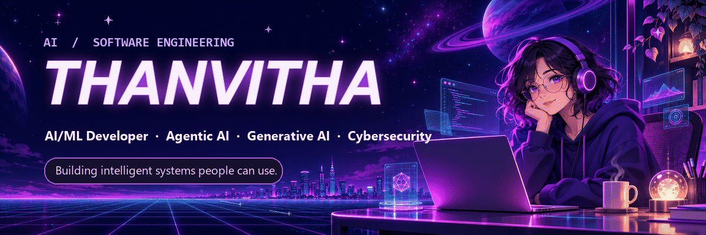
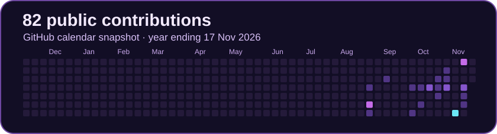

  
  
<a href="#featured-work">Featured work</a> &nbsp;·&nbsp; <a href="#toolkit">Toolkit</a> &nbsp;·&nbsp; <a href="#github-activity">Activity</a> &nbsp;·&nbsp; <a href="#connect">Connect</a>

## Hi there, I’m Thanvitha.

I’m a Computer Science student at PES University, focusing on AI and machine learning. I like taking ideas far enough to see how people might use them, whether that means tracing how an agent handled a document or turning a webcam into a drawing tool.

 

## Featured work

### SHIELD-MAS · Multi-agent security workflow

A Python workflow for screening email, PDFs, and web pages before they reach an agent. It detects prompt-injection patterns, supports sanitization and quarantine, and records source provenance in a NetworkX graph.

**Python · FastAPI · NetworkX · PyMuPDF · BeautifulSoup · pytest** 
[Explore SHIELD-MAS →](https://github.com/thanvitha-ippagunta/shield-mas-hackathon)

### Zintoo · Fashion intelligence

A quick-commerce prototype that combines text and image recommendations with demand forecasting by postal code and warehouse inventory planning.

**Python · FastAPI · MongoDB · PyTorch · Transformers · scikit-learn** 
[Explore Zintoo →](https://github.com/thanvitha-ippagunta/zintoo-ai-fashion-platform)

### PreCrash-AI · Vehicle-to-vehicle risk

A Random Forest collision-risk model paired with a live 3D traffic simulation, risk analytics, and alerts.

**Python · scikit-learn · Flask · JavaScript · Three.js · Chart.js** 
[Explore PreCrash-AI →](https://github.com/thanvitha-ippagunta/PreCrash-AI)

### VirtualAir · Gesture interface

A webcam interface that maps hand landmarks to drawing, erasing, color selection, and saving sketches.

**Python · OpenCV · MediaPipe · NumPy** 
[Explore VirtualAir →](https://github.com/thanvitha-ippagunta/VirtualAir)

### Image Quality Benchmark

A full-stack tool for comparing image search and scraping results using URL and metadata checks, quality scores, and a mock AI review.

**TypeScript · React · Node.js · Express · Vite · Tailwind CSS** 
[Explore Image Quality Benchmark →](https://github.com/thanvitha-ippagunta/Image-Quality-Benchmark)

[More repositories →](https://github.com/thanvitha-ippagunta?tab=repositories)

## Toolkit

**Programming languages** 

**AI/ML and computer vision** 

**Backend and databases** 

**Frontend and development tools** 

## GitHub activity

## Connect

I’m interested in practical applications of agentic AI, generative AI, and AI security. For project ideas or opportunities, you can [find me on GitHub](https://github.com/thanvitha-ippagunta).

---

<a href="assets/cosmic/stills.md">Still artwork and credits</a>

