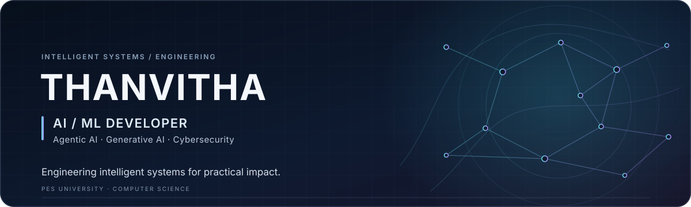

### AI/ML Developer · Agentic AI · Generative AI · Cybersecurity

**Engineering intelligent systems for practical impact.**

[Featured work](#featured-work) &nbsp;·&nbsp; [Toolkit](#toolkit) &nbsp;·&nbsp; [Current focus](#current-focus) &nbsp;·&nbsp; [Connect](#connect)

---

## About

I’m Thanvitha, a Computer Science student focused on AI/ML at PES University. I build practical software that connects machine learning and intelligent-system ideas with usable applications—from multi-agent document workflows to recommendations, forecasting, and computer vision. I’m interested in agentic and generative AI, security-minded engineering, and dependable systems.

## Featured work

<table>
<tr>
<td width="30%" align="center" valign="middle">

</td>
<td width="70%" valign="middle">

01 &nbsp;·&nbsp; MULTI-AGENT SECURITY WORKFLOW

### SHIELD-MAS

A Python workflow that routes email, PDF, and webpage inputs through specialized processing paths. It includes prompt-injection pattern detection, sanitization and quarantine components, plus a NetworkX provenance graph for tracing sources and findings.

<strong>Stack</strong> &nbsp;·&nbsp; Python · FastAPI · NetworkX · PyMuPDF · BeautifulSoup · pytest

[Explore SHIELD-MAS →](https://github.com/thanvitha-ippagunta/shield-mas-hackathon)

</td>
</tr>
</table>

<table>
<tr>
<td width="50%" valign="top">

### Zintoo · Fashion Intelligence

Quick-commerce concept joining text and image recommendations, pincode-level demand forecasting, and warehouse inventory orchestration.

<strong>Stack</strong> &nbsp;·&nbsp; Python · FastAPI · MongoDB · PyTorch · Transformers · scikit-learn · LangChain

[View project →](https://github.com/thanvitha-ippagunta/zintoo-ai-fashion-platform)

</td>
<td width="50%" valign="top">

### PreCrash-AI · V2V Risk

A Random Forest collision-risk workflow paired with a live 3D traffic simulation, risk analytics, and proactive alerts.

<strong>Stack</strong> &nbsp;·&nbsp; Python · scikit-learn · Flask · JavaScript · Three.js · Chart.js

[View project →](https://github.com/thanvitha-ippagunta/PreCrash-AI)

</td>
</tr>
<tr>
<td width="50%" valign="top">

### VirtualAir · Gesture Interface

Webcam-based air writing that turns hand landmarks into drawing, erasing, color selection, and saved sketches.

<strong>Stack</strong> &nbsp;·&nbsp; Python · OpenCV · MediaPipe · NumPy

[View project →](https://github.com/thanvitha-ippagunta/VirtualAir)

</td>
<td width="50%" valign="top">

### Image Quality Benchmark

Full-stack comparison of image search and scraping results, with URL and metadata checks, quality scoring, and a mock AI review path.

<strong>Stack</strong> &nbsp;·&nbsp; TypeScript · Node.js · Express · React · Vite · Tailwind CSS

[View project →](https://github.com/thanvitha-ippagunta/Image-Quality-Benchmark)

</td>
</tr>
</table>

More engineering work

- [Weather Prediction](https://github.com/thanvitha-ippagunta/Weather-Prediction) — Flask and scikit-learn forecasting application using Open-Meteo data.

## Toolkit

<strong>Languages</strong> 
  

<strong>AI, ML & vision</strong> 
      

<strong>Backend & data</strong> 
    

<strong>Frontend & tools</strong> 
   

## Current focus

Agentic and generative AI · practical machine learning · human-computer interaction · secure, reliable AI systems.

## Connect

For collaboration or opportunities, connect with me on [GitHub](https://github.com/thanvitha-ippagunta).

Curiosity in the questions. Care in the systems.

