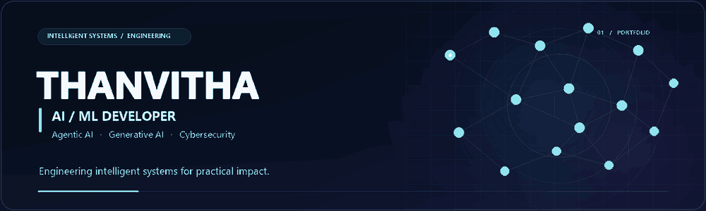
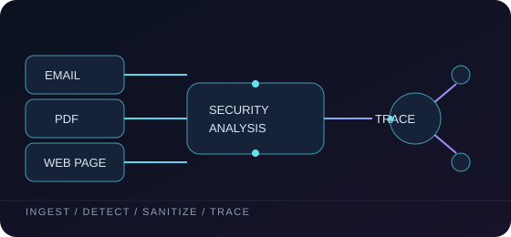
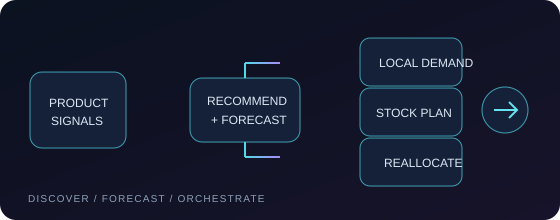
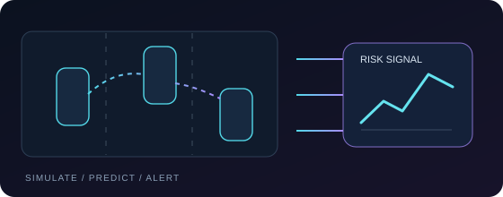
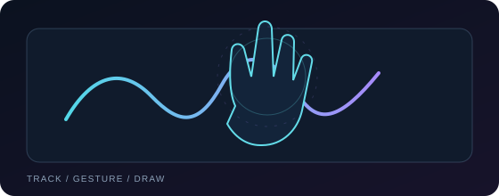
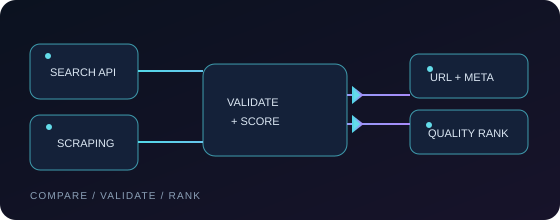

 

<a href="#featured-work">Featured work</a> &nbsp;·&nbsp; <a href="#toolkit">Toolkit</a> &nbsp;·&nbsp; <a href="#current-focus">Current focus</a> &nbsp;·&nbsp; <a href="#connect">Connect</a>

---

## About

I’m Thanvitha, a Computer Science student focused on AI/ML at PES University. I build practical software that connects machine learning and intelligent-system ideas with usable applications—from multi-agent document workflows to recommendations, forecasting, and computer vision. My current interests include agentic and generative AI, security-minded engineering, and dependable systems.

## Featured work

<table>
<tr>
<td width="36%" align="center" valign="middle"></td>
<td width="64%" valign="middle">

FEATURED SYSTEM &nbsp; / &nbsp; SECURITY ENGINEERING

### SHIELD-MAS

A Python workflow for processing email, PDF, and webpage inputs through specialized paths. It combines prompt-injection pattern detection with sanitization and quarantine components, then uses a NetworkX provenance graph to trace sources and findings.

Python · FastAPI · NetworkX · PyMuPDF · BeautifulSoup · pytest

[Explore SHIELD-MAS →](https://github.com/thanvitha-ippagunta/shield-mas-hackathon)

</td>
</tr>
</table>

 

<table>
<tr>
<td width="64%" valign="middle">

RECOMMENDATIONS &nbsp; / &nbsp; FORECASTING &nbsp; / &nbsp; ORCHESTRATION

### Zintoo · Fashion Intelligence

A quick-commerce concept joining text and image recommendations, pincode-level demand forecasting, and warehouse inventory orchestration.

Python · FastAPI · MongoDB · PyTorch · Transformers · scikit-learn · LangChain

[View project →](https://github.com/thanvitha-ippagunta/zintoo-ai-fashion-platform)

</td>
<td width="36%" align="center" valign="middle"></td>
</tr>
</table>

 

<table>
<tr>
<td width="36%" align="center" valign="middle"></td>
<td width="64%" valign="middle">

INTELLIGENT TRANSPORT &nbsp; / &nbsp; REAL-TIME SIMULATION

### PreCrash-AI · V2V Risk

A Random Forest collision-risk workflow paired with a live 3D traffic simulation, risk analytics, and proactive alerts.

Python · scikit-learn · Flask · JavaScript · Three.js · Chart.js

[View project →](https://github.com/thanvitha-ippagunta/PreCrash-AI)

</td>
</tr>
</table>

 

<table>
<tr>
<td width="64%" valign="middle">

COMPUTER VISION &nbsp; / &nbsp; HUMAN-COMPUTER INTERACTION

### VirtualAir · Gesture Interface

A webcam-based air-writing interface that maps hand landmarks to drawing, erasing, color selection, and saved sketches.

Python · OpenCV · MediaPipe · NumPy

[View project →](https://github.com/thanvitha-ippagunta/VirtualAir)

</td>
<td width="36%" align="center" valign="middle"></td>
</tr>
</table>

 

<table>
<tr>
<td width="36%" align="center" valign="middle"></td>
<td width="64%" valign="middle">

FULL-STACK APPLICATION &nbsp; / &nbsp; IMAGE EVALUATION

### Image Quality Benchmark

A comparison of image-search and scraping results with URL and metadata checks, quality scoring, and a mock AI review path.

TypeScript · Node.js · Express · React · Vite · Tailwind CSS

[View project →](https://github.com/thanvitha-ippagunta/Image-Quality-Benchmark)

</td>
</tr>
</table>

More engineering work

- [Weather Prediction](https://github.com/thanvitha-ippagunta/Weather-Prediction) — Flask and scikit-learn forecasting application using Open-Meteo data.

---

## Toolkit

<h3>Languages</h3>

 &nbsp;  &nbsp; 

<h3>AI, machine learning & vision</h3>

 &nbsp;  &nbsp;  &nbsp;  &nbsp;  &nbsp;  &nbsp; 

<h3>Backend & data</h3>

 &nbsp;  &nbsp;  &nbsp;  &nbsp; 

<h3>Frontend & tools</h3>

 &nbsp;  &nbsp;  &nbsp; 

---

## Current focus

Agentic and generative AI · practical machine learning · human-computer interaction · secure, reliable AI systems.

## Connect

For collaboration or opportunities, connect with me on [GitHub](https://github.com/thanvitha-ippagunta).

Curiosity in the questions. Care in the systems.

